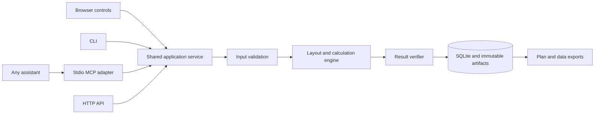

# Module 01 — Site-to-layout: Claude Cloud execution brief

Prepared 25 October 2026. This is a fresh project specification, not a claim that the application already exists.

## Your assignment

Build and demonstrate the first useful module of an open, assistant-accessible solar design platform. Research the selected reference applications, use REA on a real built application artifact, implement the scope below, and test it against independently specified acceptance cases. Deliver executable source and evidence, not another plan.

Read this file, `REA_AND_REFERENCES.md`, `ACCEPTANCE.md`, and all files in `fixtures/` before implementation. Everything necessary to understand this assignment is in this package. The references are public URLs; no previous local checkout or previous conversation is required.

The old local solar workspace was lost during storage cleanup. We are deliberately starting a new implementation. Do not reconstruct it from memory, assume old code exists, reuse previous test counts, or access a path under someone else's Mac home directory. Create a new `solar-site-layout` repository in the writable workspace supplied by your cloud environment.

## The first outcome we want

**Given a flat site outline, exclusions, module dimensions and mounting rules, tell us how many modules fit, where every module goes, and the resulting DC nameplate capacity. Produce a readable plan and transferable data.**

A successful demonstration lets a person import a site, change tilt or spacing, generate a layout, understand the quantities and assumptions, and download the plan. An assistant can perform the same operations through MCP without clicking the browser.

The mathematical result must be generated by deterministic software. The LLM interprets requests and calls tools; it does not invent coordinates, panel counts or calculation results.

This first module establishes the shared geometry, identities and service boundary needed by later terrain, electrical and energy modules. Finish and verify it before expanding those areas.

## Scope and explicit boundaries

Required:

- One valid planar Polygon or MultiPolygon, including holes, in an explicitly named metric Cartesian frame.
- Polygon exclusions with independent keepout distances; perimeter setback; uniform rectangular tables containing a rectangular grid of modules.
- Portrait or landscape modules, a single facing azimuth and tilt per layout, gaps, row pitch and table gap.
- Fixed lattice generation and a small, explicitly bounded phase search for comparing alternatives.
- Counts, DC capacity, area metrics, plan coordinates and synthetic relative module corner heights.
- A separate, limited two-dimensional row-pitch calculator, with assumptions visible.
- A browser interface, local HTTP API, CLI and stdio MCP adapter calling the same service.
- Durable project inputs and immutable results; paginated access to module/table coordinates.
- JSON, CSV, SVG and DXF exports, a calculation report, meaningful automated tests, browser screenshots and a reproducible demonstration.

Deferred:

Terrain fitting, grading, cut/fill, pile design or pile quantities, structural checks, tracker kinematics, arbitrary sloping roofs, electrical strings, inverter selection, cable routing, single-line diagrams, energy yield, financial returns, code compliance, satellite maps, WGS84 reprojection, accounts, billing and public deployment. Do not display placeholder results for these features.

The result is a preliminary layout under stated assumptions. Neither reference-app agreement nor a passing geometry test makes it a construction approval. Do not call a bounded lattice search a globally optimal solar plant design.

## Research and reuse strategy

Use the selected references described in `REA_AND_REFERENCES.md`:

1. Agrivoltaic garden planner: the practical browser-artifact REA target, plus reference behavior for array controls, geometry presentation and state changes. Its garden scope is deliberately narrower and different from our site clipping problem.
2. PVPlant/FreeCAD: a secondary reference for table/module parameterization and CAD design concepts. Normal source reading is sufficient for this reference; installing FreeCAD is optional.
3. pvlib: a numerical reference library for solar conventions and later energy work. This module does not require an annual simulation or online weather data.

Do not spend the whole run installing a CAD application. Ordinary source exploration is not REA evidence. Conversely, a REA graph is not evidence of numerical correctness. Keep artifact observations, source observations, runtime observations and independent calculations separately labelled.

Use existing, maintained geometry and file-format libraries where appropriate. Do not reimplement polygon Boolean operations, a DXF parser, an MCP transport or a solar ephemeris just to avoid dependencies. Record actual versions and licences. Reading public code does not justify a clean-room claim; attribute any copied or adapted code explicitly.

## Geometry and coordinate contract

The included input examples are proposed `solar.layout.request/1` contracts. Finalize JSON Schemas before generating outputs; document any necessary changes and migrate these fixtures explicitly. Do not silently reinterpret them.

### Frame and units

- Input/output x is East and y is North in metres. North means the declared frame's north; no grid convergence correction is performed.
- `frame.kind` is `local_cartesian` or `projected_cartesian`; both are metric Cartesian computations. A projected frame must retain its supplied CRS identifier, but this module performs no transformation.
- Our `boundary` object uses GeoJSON geometry shapes inside a custom, framed request. This is not an RFC 7946 geographic GeoJSON export. Do not label metre coordinates as longitude/latitude.
- Reject unlabelled units, geographic degree inputs, non-finite values, invalid rings, self-intersections and unsupported Z-bearing site coordinates with typed field errors. Do not silently repair an invalid site.
- Set an explicit supported envelope: absolute coordinate magnitude at most 10,000,000 m, site bounding-box diagonal at most 20,000 m, and positive module dimensions at least 0.05 m. Return a typed limit error beyond the declared range.
- Internally translate into a well-conditioned local frame before rotations, clipping or area work. Keep the original reference frame and inverse transformation in the result. Never shrink or enlarge the user's site to make a result pass.

### Table geometry

Let `A` be panel facing azimuth in degrees clockwise from North: North 0, East 90, South 180, West 270. Let `beta` be tilt above horizontal, in `[0,80]` degrees.

In East/North coordinates define the unit table-width axis and the uphill axis:

```text
u = (-cos(A),  sin(A))
v = (-sin(A), -cos(A))
```

Convert degrees to radians before trigonometry. At A=180, u points East and v points North. This makes a south-facing table rise towards North. Normalize equivalent azimuth inputs consistently.

Represent exact cardinal directions with exact 0/±1 axes rather than residual sine/cosine values. Otherwise a mathematically tangent footprint can become a tiny outside crossing. This is an axis representation rule, not permission to move arbitrary input geometry.

For portrait, module width `w` is the supplied short-side width and uphill length `l` is the supplied length. Landscape swaps them. Module gaps in the request are measured in the table plane.

```text
W = columns*w + (columns-1)*module_gap_x
L = rows*l    + (rows-1)*module_gap_y
D = L*cos(beta)             horizontal projected table depth
H = L*sin(beta)             total rise
```

For table lower-edge corner origin `o`, module-plane coordinates `(a,b)` transform as:

```text
xy = o + a*u + b*cos(beta)*v
z_relative = lower_edge_height + b*sin(beta)
```

Emit module corners in a documented consistent order, plus the horizontal table footprint. Keep the gaps: a module does not include the empty space between modules. `z_kind` must explicitly be `relative_flat_datum`, with the layout's synthetic z=0 reference. This is not a surveyed elevation or a terrain acceptance.

### Placement

For the fixed lattice, the request's anchor is an explicit world-frame point. Candidate table origins are:

```text
o(i,j) = anchor + i*(W + table_gap)*u + j*row_pitch*v
```

`i,j` are integers, including negative values where necessary. Candidate generation must cover the site's transformed bounding box, then test actual geometry. Row pitch is lower-edge to lower-edge distance, not clear spacing. Require `row_pitch >= D + minimum_clear_row_gap`, within a declared numerical policy; reject physically overlapping rows rather than quietly changing their pitch.

Build the admissible region from the inward perimeter setback, polygon holes and outward exclusion keepouts. The perimeter setback applies to all site boundary rings, including hole edges; an exclusion has its separate keepout. State join style and curve approximation policies. Keepouts are true minimum distances; an approximation to a circular buffer must not understate the requested distance. Validate original-boundary distances independently where the representation alone is insufficient.

A complete table footprint must lie in the admissible region. Checking its centre or four corners alone is insufficient for a concave site or hole. Exact tangency is allowed at a zero margin or exactly at a requested minimum distance; crossing into a forbidden interior is not. Drop entire invalid tables; do not cut modules or produce partial tables.

For phase search, evaluate a documented finite 3×3 set of offsets within the lattice period, including zero phase. Keep table type, tilt, azimuth and pitch unchanged. Maximize placed module count over those nine candidates; use a stable tie-break on phase indices. Return all nine scores, the selected phase, the search scope and `optimality: best_of_evaluated_candidates`. The fixed-lattice fixtures must bypass phase search.

Numerical policies must specify distance, area and serialization tolerances separately. Do not hide failures with an arbitrary positive site buffer, an area-only sliver allowance or a fixed tolerance copied across dimensionally different checks. For an uncertain borderline case, return a diagnostic or conservatively omit that candidate; report why. Run translated and rotated cases across the supported envelope.

## Calculations

Required quantities, with definitions in machine-readable output and the report:

```text
module_count = table_count * rows * columns
dc_capacity_kwp = module_count * module_power_wp / 1000
physical_module_area = module_count * supplied_width * supplied_length
projected_module_area = physical_module_area * cos(beta)
table_footprint_area = table_count * W * D
gross_site_area = area(original polygon including its holes)
buildable_area = area(admissible region after setbacks/exclusions)
module_ground_coverage_gross = projected_module_area / gross_site_area
module_ground_coverage_buildable = projected_module_area / buildable_area
```

Distinguish module projected area from the table envelope, which includes gaps. A fully excluded site returns a successful empty layout with zero counts, a clear warning and null ratios whose denominator is zero. There is no assumed annual kWh or inverter AC capacity.

### Limited row-pitch calculator

Implement this separately from placement. It assumes flat ground, identical coplanar tables at equal lower-edge height, an infinitely long row, and direct sun coming perpendicular to the row from the panel-facing side. The user supplies solar elevation `alpha` in `(0,90]` degrees; we do not infer it from a city name.

```text
shadow_clear_gap = H / tan(alpha)
pitch_at_that_elevation = D + shadow_clear_gap
recommended_pitch = max(D + minimum_clear_row_gap, pitch_at_that_elevation)
```

Do not use lower-edge height instead of H. Do not call this an all-year shading guarantee, an obstacle shading model or an energy-loss estimate. In this release arbitrary solar azimuth and date/time windows are unsupported; return a typed unsupported-input error if requested. Display “2D row-spacing estimate at the specified solar elevation”. Values near the horizon must produce a bounded diagnostic, not overflow.

The independent tilted example in `fixtures/pitch-3-4-5.expected.json` uses a 5 m slope length, tilt `atan(3/4)`, D=4 m, H=3 m and alpha=45°. Expected pitch is 7 m. Flat tilt yields H=0 and only the requested clear gap remains.

## Application architecture

Prefer Python 3.12+, Shapely/GEOS, typed request/response models, SQLite, a small HTTP service and a lightweight browser frontend. A CLI and MCP SDK adapter call the same application service. Equivalent architecture is allowed if justified early and it meets every contract and cloud portability requirement.



Do not require a CAD installation, browser automation or a running LLM to calculate a layout. Use direct application calls for production operations; browser automation belongs to reference investigation and UI tests.

The first release runs locally or inside the cloud execution container. Bind HTTP to loopback by default; use the platform's preview facility when available. A later authenticated remote service can expose the same domain operations to many users. Stdio MCP in this module does not by itself implement remote multi-user access, and no Mac-specific plugin is involved.

### Service operations

Define these operations once and map them to CLI/HTTP/MCP:

- `validate_request`: normalized diagnostics, dimensions and estimated candidate bounds; no persisted layout.
- `calculate_row_pitch`: limited calculator above with assumptions and intermediate values.
- `create_project`, `get_project`, `update_project`: typed inputs, integer revision, expected revision on changes.
- `generate_layout`: consumes an immutable input snapshot or a specified project revision; returns result ID, input digest, summary and artifact links.
- `get_layout_summary`, `get_layout_items`: stable ordering with offset/cursor and bounded page size. Default 100 items, maximum 500; never silently truncate.
- `export_layout`: explicit result ID and format, writing inside a managed export root.

Generating an immutable result does not silently replace the active editable specification. Bind any project selection of that result to its source revision; reject stale selection or retain it as an explicitly historical result. Define this behavior before implementation.

Use typed errors such as `INVALID_GEOMETRY`, `UNSUPPORTED_FRAME`, `INVALID_PITCH`, `REVISION_CONFLICT`, `RESOURCE_LIMIT`, `RESULT_NOT_FOUND` and `UNSUPPORTED_OPERATION`. HTTP and MCP must preserve the same domain error code, while using their appropriate transport envelopes.

### Persistence and identity

- Separate editable project revision, normalized input digest, result identity and artifact byte hash. Exclude timestamps and transport metadata from numerical identity.
- Result provenance includes schema version, algorithm version, geometry policy version, dependency versions and source commit. Same normalized input and algorithm policy produces the same numerical payload/digest, irrespective of interface or restart.
- Preserve table lattice indices and per-table module row/column indices. IDs must be deterministic within a result. Do not claim identity continuity across edited layouts unless explicitly implemented and tested.
- Store module/table records so paging does not load the full result JSON into memory. Never make a “summary” read deserialize an unbounded coordinate file.
- Keep the supplied module nameplate power as the only known electrical rating. Do not infer voltage, current, inverter compatibility or structural support geometry from dimensions or power. Future modules must request those inputs explicitly.
- Use transactions and compare-and-swap project updates across separate processes. Do not rely solely on an in-process lock.
- Interrupted generation must not leave a successful result or artifact pointer to incomplete data. Generation may be synchronous and bounded; a durable background-job framework is not required for this module.
- The browser captures the submitted input revision/digest. If inputs change while generation is pending, show the completed result as belonging to the old input, leave new edits dirty, and do not present the result as current.

## Browser and export experience

The browser starts with a small example, offers an input file import and clear controls for module size, orientation, table rows/columns, tilt, facing azimuth, spacing and setbacks. Show units beside the fields. Include fit-to-site, zoom, layer toggles, counts and an export action. A plain coordinate editor is acceptable; a satellite basemap and freehand CAD editor are unnecessary.

The plan shows original site, admissible region, exclusions, tables and modules, with a north arrow, metre scale, legend, input/result revision and assumptions. Show gaps honestly. Keep model geometry in East/North coordinates even though screen y increases downwards.

Export:

- JSON: complete normalized inputs and result provenance, with all geometry or an explicit packaged coordinate file.
- CSV: one row per module; IDs, table indices, local row/column, world-frame corner coordinates, relative z values and power. Define column order and numeric formatting.
- SVG: a dimensionally coherent vector plan with readable annotations; do not confuse drawing millimetres with site metres.
- DXF: named layers, closed polylines, metre unit metadata and original world coordinates. Reopen with a parser and compare entities and extents against the result.
- Calculation report: Markdown or HTML, with intermediate dimensions, capacity arithmetic, area definitions, pitch assumptions and warnings. A PDF is optional; no document rendering service is required.

Machine exports must originate from the same immutable result as the browser. Each export bundle includes an input/result digest, frame, versions and SHA-256 of every output file.

## Execution milestones

Complete in this order. Relative effort allocations are planning guides, not deadlines or excuses to skip verification.

1. **Reference evidence and contracts, roughly 15%.** Inspect environment; pin references; execute the bounded REA investigation; record what is and is not established. Finalize schemas and mathematical conventions. Produce a concise implementation plan and start coding in the same run.
2. **Numerical core, roughly 35%.** Implement validation, framing, table geometry, clipping, fixed lattice, quantities, pitch calculator, verifier and analytic fixtures. Pass the large-coordinate regressions before UI work.
3. **Service and exports, roughly 20%.** Durable inputs/results, bounded search, page access, CLI, HTTP, export consistency and restart behavior.
4. **Browser and MCP, roughly 15%.** One usable workflow plus a real MCP client session; test the delayed-generation edit case.
5. **Independent verification and delivery, roughly 15%.** Execute the acceptance matrix, inspect drawings, record limitations and package the final checkpoint.

If reference setup blocks progress, timebox diagnosis to 90 minutes, record exact errors and continue the independent core. The affected evidence gate remains blocked; do not report full completion without it. Do not spend the run fixing unrelated upstream projects or expanding scope.

## Cloud environment and authorization

You may use the supplied cloud workspace, create a Git repository there, clone the named public references, download pinned dependencies/tool packages, run local development servers and headless Chromium, and install project/container-scoped prerequisites. Use actual available tools; an ordinary chat with no execution environment cannot perform this build and must say so.

This does not authorize purchases, account creation, public deployment, emails/messages to other people, modifying a user's desktop configuration, bypassing access controls or deleting unrelated files. Prefer REA CLI in the container to changing MCP client registration. No desktop-only Hopper or Mac automation is needed.

Install source dependencies in isolated environments. Record lockfiles, tool versions and downloaded reference hashes. Keep reference checkouts, built reference artifacts, evidence and our application in separate folders. Do not run reference `deploy`, `build:deploy`, cloud-secret or model-download scripts. The selected browser reference has unrelated AI/weather features; keep those out of the investigation and our runtime.

Use available agent delegation only if the session supports it and it improves verification; keep one owner for each file. You may delegate an independent numerical/review task, but the lead must review the result. Do not invent tool access or claim a separate audit that did not happen.

## Persistence of the work itself

Commit each verified milestone locally. At every milestone update `CHECKPOINT.md`: exact commit, what passed, failures, how to resume and the next operation. Package source and a Git bundle into the cloud environment's downloadable output area; exclude virtual environments, caches, downloaded browsers and large reference checkouts.

At delivery attach the source archive and Git bundle to the chat using the environment's actual downloadable-artifact mechanism. A local Git commit is not an off-machine backup. Do not claim backup protection until a downloadable artifact or an authorized external copy exists.

## Final deliverables

1. Executable `solar-site-layout` source, dependency locks, schemas and reference adapters/probes.
2. `README.md` with installation, example commands, browser startup and MCP client configuration; include Linux-tested status and actual Mac/Windows status.
3. `reports/REFERENCE_FINDINGS.md`, REA Evidence and artifact manifest, plus the claim-to-evidence table.
4. `reports/ACCEPTANCE.json` containing every gate from `ACCEPTANCE.md`, with pass/fail/blocked/unexecuted, commands, evidence paths and source commit. Do not silently remove difficult gates.
5. Exact analytic examples, concave/hole/MultiPolygon layouts, rotated projected-coordinate regression outputs, an actual browser screenshot and a full MCP transcript.
6. `reports/BENCHMARKS.json` with machine description, sizes, elapsed time and measured peak memory.
7. `DELIVERY_REPORT.md` explaining what works, significant bugs found/fixed, remaining limitations, and specific next actions for Module 02.
8. A source ZIP, a Git bundle, SHA-256 manifest and a clean-checkout reproduction log.

Full completion requires the mandatory acceptance gates on final source. A high test count is not the target. If something remains blocked, deliver the working portions and clearly name the failed gate and the concrete action needed; do not relabel it as pass.

After review, these immutable table/module outputs can feed separate terrain and electrical modules. Terrain can replace the synthetic datum with explicitly accepted rack planes; electrical can add real nameplate models and string assignments while retaining source identities. Energy yield follows with its own weather and shading evidence. Do not build these future modules during this assignment.

Begin by checking the cloud environment, reading the reference plan and confirming the fixture arithmetic. Then execute the reference investigation and implement the first numerical slice. Continue until a reviewable application and its evidence are delivered.
